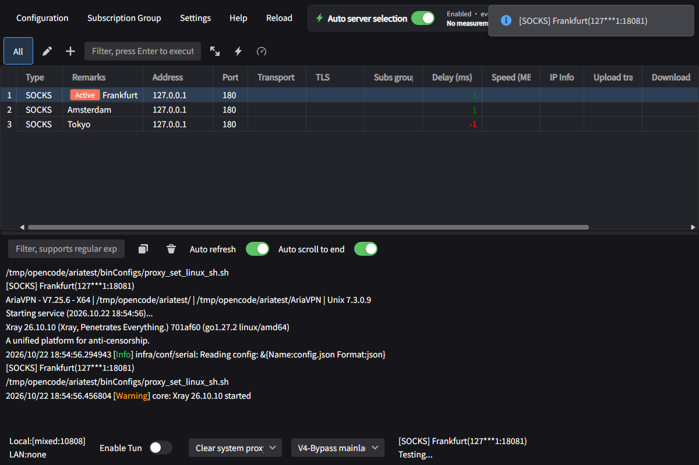
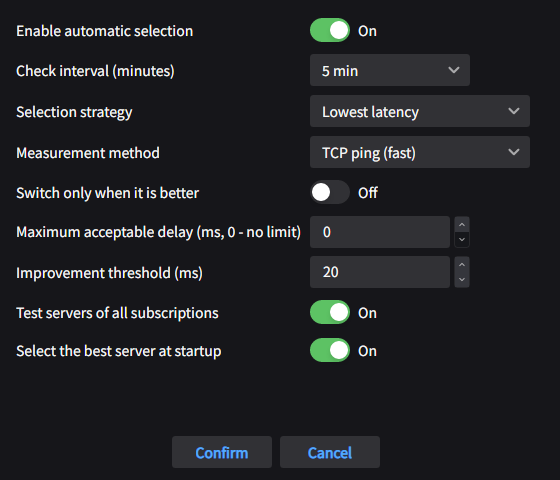

# AriaVPN

A desktop VPN client with **automatic server selection**, built on top of
[v2rayN](https://github.com/2dust/v2rayN) (Avalonia UI, .NET 10).

AriaVPN keeps everything v2rayN does — subscriptions, routing, multiple cores,
system proxy, TUN mode — and adds a simple idea on top: measure the servers
regularly, pick the best one and switch to it automatically.



## Automatic server selection

* **Periodic measurements** — delay is measured for every eligible server
  (TCP ping, real ping, UDP test or a mixed test), then the best server is
  selected. The first measurement runs shortly after start-up, the following
  ones at the configured interval (1–1440 minutes).
* **Four strategies**
  * **Least ping** — the server with the lowest delay.
  * **Fastest** — the server with the highest measured speed.
  * **Random** — a random reachable server (useful to spread the load).
  * **Fallback** — keep the current server while it is reachable.
* **Continuous best-server mode** — re-check the servers every few seconds and
  keep the fastest one active. Only servers that can be activated through the
  Xray API take part, so the core is never restarted and established
  connections are not interrupted. The mode can be toggled from the card, the
  menu and the tray icon.
* **Smart switching** — switch only when the new server is better by a given
  margin, ignore servers above a maximum delay, use all subscriptions or only
  the current one, and pick the best server on start-up.
* **Transparent** — the active server is switched in the running Xray core, so
  existing connections are kept; the list and a notification show what happened.
  In the regular mode, the core is restarted only when a seamless switch is not
  possible.



## Features

* Xray and sing-box cores, VLESS / VMess / Trojan / Shadowsocks / SOCKS / HTTP /
  TUIC / Hysteria2 / AnyTLS / WireGuard and more.
* Subscriptions with automatic updates, routing rules, DNS settings, TUN mode.
* Live server switching for Xray without dropping connections, automatic core
  restart as a fallback, a light card-based interface with uniform rounded
  corners and ten themes, including the custom **Aria**, **Midnight** and
  **Graphite** palettes.
* Tray icon shows the current state and offers automatic selection, continuous
  best-server mode and "select the best server now".
* English user interface.

## Install (Debian / Ubuntu)

```bash
sudo dpkg -i aria-vpn_7.25.12_amd64.deb
aria-vpn
```

The package installs into `/opt/AriaVPN`. User data (configuration, logs,
downloaded cores) is stored in `~/.local/share/AriaVPN` and is copied there on
the first run.

## Build from source

Requirements: .NET SDK 10, `dpkg-deb` (for the package).

```bash
# build the GUI
dotnet build v2rayN/v2rayN.Desktop/v2rayN.Desktop.csproj -c Release

# run the unit tests of the selection logic
dotnet run --project v2rayN/v2rayN.Tests/AriaVPN.Tests.csproj -c Release

# build the .deb (cores are taken from a local directory)
./package-aria-vpn.sh 7.25.12 --cores /opt/AriaVPN/bin
```

The cores directory must have the layout of the official v2rayN release
archive: `xray/xray`, `sing_box/sing-box`, `srss/`, `*.dat`, `Country.mmdb`.

If NuGet restore hangs on an IPv6-broken network, set
`DOTNET_SYSTEM_NET_DISABLEIPV6=1`.

See [docs/DEVELOPMENT.md](docs/DEVELOPMENT.md) for the implementation notes.

## Project layout

| Path | Description |
|---|---|
| `v2rayN/ServiceLib/Services/AutoSelectService.cs` | background loop, measurements and the selection itself |
| `v2rayN/ServiceLib/Manager/CoreManager.cs` | core lifecycle and the Xray hot server switch |
| `v2rayN/ServiceLib/ViewModels/AutoSelectViewModel.cs` | the card in the main window |
| `v2rayN/ServiceLib/ViewModels/AutoSelectSettingViewModel.cs` | settings window |
| `v2rayN/v2rayN.Desktop/Views/AutoSelectView.axaml` | the auto selection card |
| `v2rayN/v2rayN.Desktop/Views/AutoSelectSettingWindow.axaml` | the auto selection settings window |
| `v2rayN/v2rayN.Tests/Program.cs` | self tests of the selection logic |
| `package-aria-vpn.sh` | `.deb` packaging script |

## License

GNU General Public License v3.0 — see [LICENSE](LICENSE).

AriaVPN is a fork of [v2rayN](https://github.com/2dust/v2rayN) by 2dust and
contributors. All credit for the original application, the cores integration
and the UI toolkit usage belongs to the upstream project.
